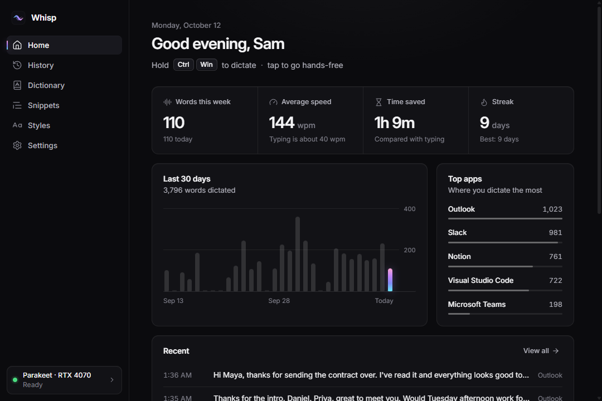
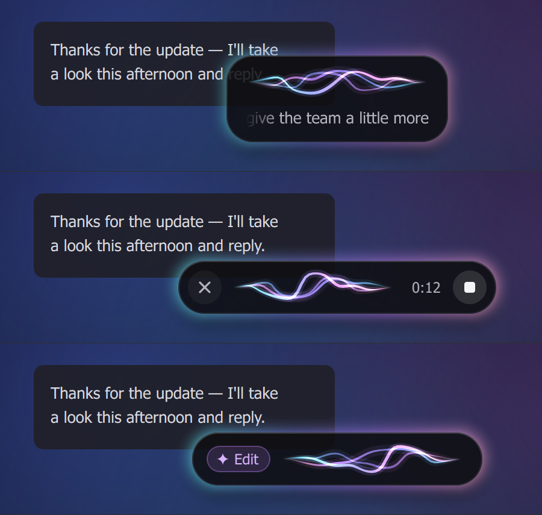
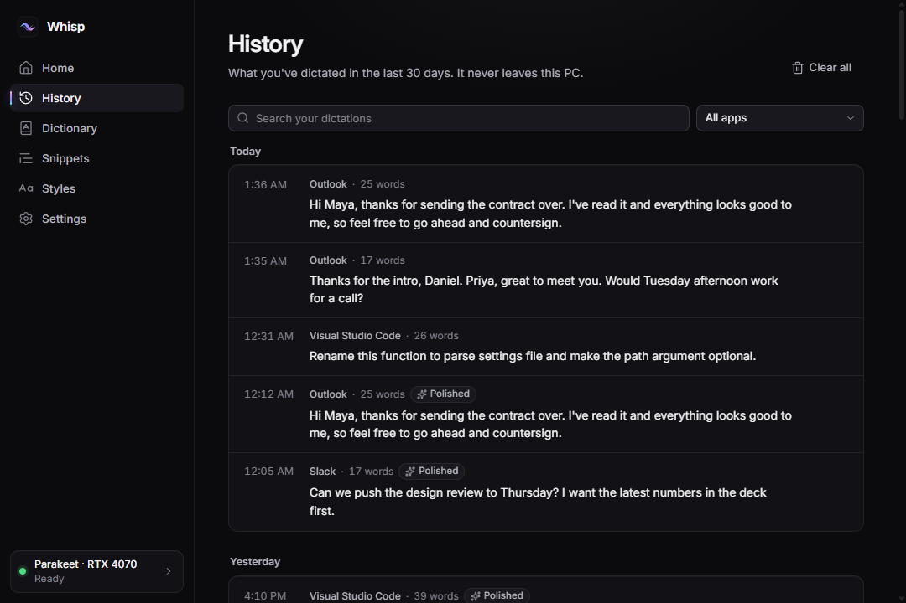
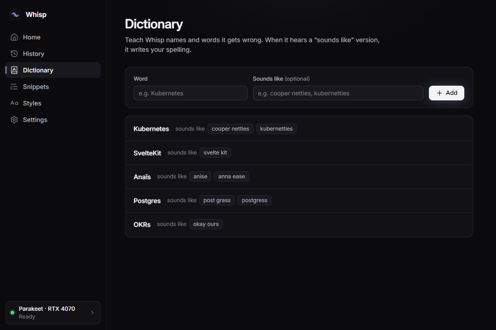
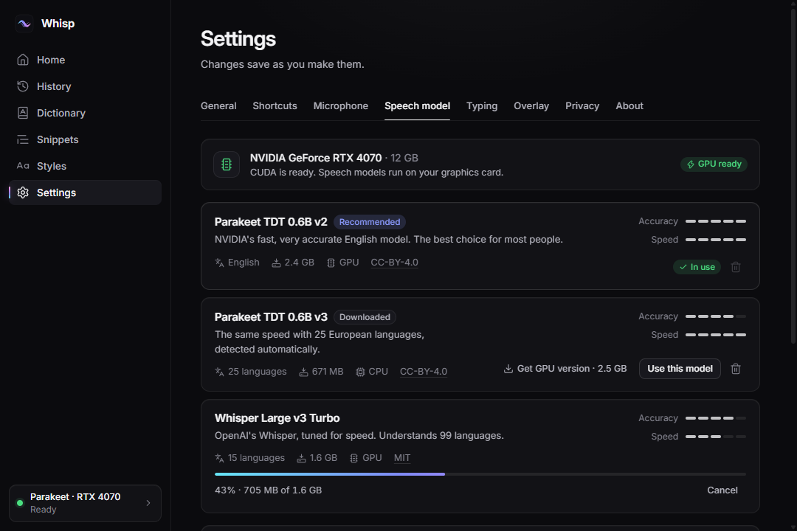

<p align="center">
  
</p>

<h1 align="center">Whisp</h1>

<p align="center">
  Talk instead of type, anywhere on Windows.<br>
  Hold a shortcut, speak, let go, and clean text appears where your cursor is.<br>
  Free, open source, and everything runs on your PC.
</p>



## Why Whisp

- **Private.** Your voice becomes text on your own PC. No account, no cloud, no tracking.
- **Free.** Open source under the MIT License.
- **Fast.** Whisp transcribes while you talk, so your words land moments after you let go.
- **Works everywhere.** Email, chat, documents, code editors, terminals: any app you can type in.
- **Works offline.** Once you've downloaded a speech model, Whisp needs no internet.

## Features

**Dictation**

- Hold **Ctrl + Win**, speak, and let go. Your words are typed where your cursor is.
- Tap the shortcut instead to go hands-free. Tap again to stop. **Esc** cancels.
- A small overlay shows that Whisp is listening, with a live preview of your words. It never takes focus from the app you're typing in.
- **Command mode:** select some text, hold **Ctrl + Win + Alt**, and say how to change it, like "make this friendlier". Needs AI polish (below).
- Paste your last dictation again, or copy it to the clipboard, with a shortcut.
- Mutes music and videos while you talk, so Whisp hears you clearly. Calls and apps using a microphone stay on.

**Speech recognition on your PC**

| Model | Languages | Download |
|---|---|---|
| Parakeet TDT 0.6B v2 (recommended) | English | 631 MB (CPU) or 2.3 GB (GPU) |
| Parakeet TDT 0.6B v3 | 25 European languages, detected automatically | 639 MB (CPU) or 2.4 GB (GPU) |
| Whisper Large v3 Turbo | 99 languages | 1.0 GB (CPU) or 1.5 GB (GPU) |

Whisp uses your NVIDIA graphics card when it can, and your processor otherwise.

**Clean text**

- Removes filler words like "um" and "uh", and stutters like "I I think". (AI polish also cleans up false starts.)
- Voice commands: say "new line", "new paragraph" or "scratch that". In English you can also say punctuation, like "comma" or "question mark".
- Adds a space when you carry on a sentence in a new dictation, even after working in another app in between.
- **Styles:** choose Verbatim, Clean, Casual or Formal for each kind of app (messaging, email, code, documents and the rest). Whisp picks the style from the app you're typing in.
- **Dictionary:** teach Whisp names and words it gets wrong, with "sounds like" spellings.
- **Snippets:** say a short phrase like "my calendar link" and Whisp types the full text.
- **AI polish (optional):** a language model fixes grammar and wording. Use the built-in one, which runs on your PC (Qwen3.5 or Gemma 4 on llama.cpp), or your own Ollama or OpenAI-compatible server. Add your own instructions, like "Use British spelling". If polishing takes too long, Whisp types your words without it.

**Fits the way you work**

- Pastes or types your text. Some apps, like terminals, can get their own method.
- Puts back whatever was on your clipboard before.
- If you switch windows while Whisp is working, your words wait on the clipboard instead of landing in the wrong place.
- **History:** search, filter by app and copy past dictations. Choose how long they're kept, or turn history off.
- **Stats:** words this week, speaking speed, time saved, your streak, the last 30 days and your top apps.
- Light and dark themes, start and stop sounds, launch at sign-in, and a tray menu to pause Whisp or switch microphones.

## Screenshots

The overlay while you dictate: live preview, hands-free with a timer and stop button, and command mode.



| History | Dictionary | Speech models |
|---|---|---|
|  |  |  |

The window screenshots show sample data.

## Install

1. Download `Whisp-Setup-<version>.exe` from this project's Releases page.
2. Run it. Whisp installs just for you, into `%LOCALAPPDATA%\Programs\Whisp`. No administrator rights needed.
3. The installer isn't code-signed yet, so Windows SmartScreen may warn you. Choose **More info**, then **Run anyway**.
4. A short setup opens. Pick your microphone, download a speech model (once), set your shortcut and try it out.

Whisp then waits in the notification area, next to the clock. Hold **Ctrl + Win** in any app to dictate.

- **Update:** run the new installer. It closes Whisp, replaces it and keeps your settings.
- **Uninstall:** open Windows Settings → Apps → Installed apps → Whisp → Uninstall. It asks whether to delete your settings, history and downloaded models too.
- **Silent install:** the installer takes Inno Setup's usual options, for example `/VERYSILENT`.

## What you need

- 64-bit Windows 10 (version 1809 or later) or Windows 11.
- A microphone.
- About 650 MB of disk space for Whisp, plus 631 MB to 2.4 GB for a speech model.

**An NVIDIA graphics card is optional.** Whisp runs well on a modern processor; the CPU versions of the models are built for it. With an NVIDIA card (GeForce GTX 16 or RTX 20 series or newer, with driver 580 or newer), open Settings → Speech model and choose **Turn on GPU speed**. Whisp downloads NVIDIA's CUDA libraries once (1.1 GB) and then runs speech recognition on the graphics card.

**AI polish is optional too.** The built-in models are a 1.2 to 4.4 GB download. They run on an NVIDIA, AMD or Intel graphics card (with about 1.8 to 3.7 GB of graphics memory) or on the processor (about 2 to 5.6 GB of memory).

## Shortcuts

| Action | Default shortcut |
|---|---|
| Dictate | Hold **Ctrl + Win**, let go to insert |
| Hands-free | Tap **Ctrl + Win**, or press **Ctrl + Win + Space**. Do it again to stop. |
| Command mode | Select text, then hold **Ctrl + Win + Alt** and say what to change |
| Paste last dictation | **Alt + Shift + Z** |
| Copy last dictation | **Alt + Shift + X** |
| Cancel | **Esc** while Whisp is listening |

Change them in Settings → Shortcuts.

## Privacy

What you say never leaves your PC, unless you choose an AI server on another computer for AI polish.

**What Whisp stores, and where:**

| What | Where |
|---|---|
| Settings, dictionary and snippets | `%APPDATA%\Whisp` |
| Dictation history | `%LOCALAPPDATA%\Whisp\history.db` |
| Speech and AI models | `%LOCALAPPDATA%\Whisp\models` |
| GPU runtime pack and the built-in AI server | `%LOCALAPPDATA%\Whisp\runtime` |
| Logs | `%LOCALAPPDATA%\Whisp\logs` |

- History is kept for 30 days by default. You can change that, clear it, or turn it off. With history off, Whisp keeps only word counts, timings and app names for your stats, and offers to delete what was saved before. Deleted entries are overwritten on disk.
- Logs never contain what you said, your clipboard or window titles.
- The text Whisp puts on the clipboard to paste (or copy from History) is kept out of Windows clipboard history and cloud clipboard.
- Command mode is the exception: it copies your selected text with Ctrl + C, so Windows clipboard history (Win + V) may keep that selection.
- An API key for your own AI server is encrypted with your Windows account and never shown again.
- The built-in AI server only listens on your own PC and needs a new random key each time it starts, so web pages and other people's accounts can't use it.
- ONNX Runtime's usage telemetry is switched off.

**When Whisp goes online:** only to download what you ask for. That's speech models and AI models (from Hugging Face), the GPU runtime pack (NVIDIA's packages from PyPI) and the built-in AI server (llama.cpp from GitHub). Every file is pinned to an exact version and checked before use. Secure connections trust the certificates Windows trusts, so downloads work on company networks too. There's no telemetry, no account and no automatic update check.

**AI polish with your own server:** if you choose Ollama or an OpenAI-compatible server, Whisp sends your dictated text to that server to polish it. If the server runs on another computer or in the cloud, your text goes there.

Uninstalling asks before it deletes any of these folders.

## Models and licences

| Model | Used for | Licence |
|---|---|---|
| Parakeet TDT 0.6B v2 and v3, by NVIDIA | Speech recognition | CC BY 4.0 |
| Whisper Large v3 Turbo, by OpenAI | Speech recognition | MIT |
| Qwen3.5 4B and 2B, by the Qwen team (Alibaba Cloud) | AI polish | Apache 2.0 |
| Gemma 4 E4B, by Google | AI polish | Apache 2.0 |
| Silero VAD (included with Whisp) | Telling speech from silence | MIT |

Whisp downloads the models from Hugging Face when you choose them. Whisp's own code is MIT-licensed. It ships with Qt and Qt for Python (LGPL-3.0), ONNX Runtime (MIT) and other open-source libraries. [THIRD_PARTY_NOTICES.md](THIRD_PARTY_NOTICES.md) lists every one, with credits and licences.

## Run from source

You need Windows 10 or 11 and [uv](https://docs.astral.sh/uv/). Clone this repository, then in its folder:

```powershell
uv sync          # creates .venv with Python 3.12 and everything Whisp needs
uv run whisp     # starts Whisp
```

- For GPU speed from source, install NVIDIA's libraries into the environment: `uv sync --extra cuda`.
- `uv run python -m whisp --diagnostics` prints versions, GPU status and file locations.
- Set `WHISP_HOME` to a folder to keep all of Whisp's settings and data there instead.

**Build the app and installer:** `.\scripts\build.ps1` builds `dist\Whisp\`. Add `-Installer` to also build `dist\Whisp-Setup-<version>.exe`; that needs [Inno Setup](https://jrsoftware.org/isinfo.php) 6.7 or later.

## Contributing

Bug reports, ideas and pull requests are welcome. [CONTRIBUTING.md](CONTRIBUTING.md) explains the setup, tests and checklist. To report a security problem privately, see [SECURITY.md](SECURITY.md).

## Licence

Whisp is released under the [MIT License](LICENSE). Third-party components keep their own licences: see [THIRD_PARTY_NOTICES.md](THIRD_PARTY_NOTICES.md).
